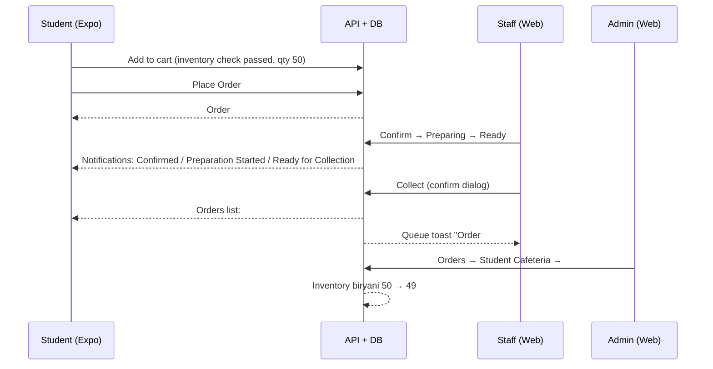

# FINAL CLIENT ACCEPTANCE TEST — UniServe

**Date:** 2026-10-08
**Test type:** Final client acceptance & end-to-end product test (real client interfaces, real accounts, real data, real images)
**Executed by:** Automated client-driving test session (browser-level interaction with the running product — no API shortcuts for client-facing claims)
**Constraint compliance:** No source changes, no dependency changes, no lockfile changes, no commits. All defects observed were recorded, not silently fixed.

---

## 1. Environment

| Component | Details | Status |
|---|---|---|
| API | `uniserve_api` Docker container, `http://localhost:8000` | healthy (ready / connected / present) |
| Database | `uniserve_postgres` (postgres:16-alpine), host port 5433 → 5432, DB `uniserve_prod`, user `uniserve` | healthy |
| Web console (Admin / Manager / Staff) | Next.js 14 dev server, `http://localhost:3000` | running |
| Mobile client (Student / Faculty) | Expo web, `http://localhost:8081` | running |
| Git baseline | HEAD `bc967b35fccaf7bb6c1b3a4b31e356000bd788ee` (main) | unchanged at test end |
| package-lock.json | SHA-256 `3AE3D031F90A7608E854E4B34A147ECEE12C63634F96F9D7BB70EF9C4694C5D8` | unchanged at test end |

All interfaces were opened and driven in a real browser. Every rendering claim below corresponds to a screenshot that was captured and (for images) visually inspected.

## 2. Accounts used

| Role | Email | Password | Scope | Client used |
|---|---|---|---|---|
| System Administrator | admin@lgu.edu.pk | Admin123! | University-wide (3 cafeterias) | Web console :3000 |
| Cafeteria Manager | sana.malik@lgu.edu.pk | TestPass123! | Faculty Cafeteria only | Web console :3000 |
| Cafeteria Staff | ahmed.raza@lgu.edu.pk | TestPass123! | Student Cafeteria | Web console :3000 |
| Student | ayesha.khan@student.lgu.edu.pk | TestPass123! | Student Cafeteria (verified FA22-001) | Expo web :8081 |
| Faculty | dr.sana.malik@lgu.edu.pk | TestPass123! | Both cafeterias (FAC-101) | Expo web :8081 |

Cafeteria IDs: Student `84ab69bb-ea39-451f-aec7-427922795ca8`, Faculty `287038a2-8f8d-494c-bea5-42ff24550136`, Phase 56 E2E `50d67d4b-841b-43c4-b60d-eeb1cf68152a` (pre-existing test-residue cafeteria, left untouched).

## 3. Menu creation test (via UI — Phase C)

Four new realistic menu items were created **through the admin web console UI** ("Add Menu Item" modal on `/dashboard/menu`), all in Student Cafeteria:

| Item | Category | Price | Dietary | Inventory auto-created |
|---|---|---|---|---|
| Chicken Biryani (Student Special) | main_course | PKR 250 | halal, wheat | yes, quantity **0** |
| Chicken Pasta Alfredo | main_course | PKR 280 | — | yes, quantity **0** |
| Fresh Lime Juice | beverage | PKR 120 | — | yes, quantity **0** |
| Cold Coffee | beverage | PKR 150 | — | yes, quantity **0** |

All 4 appeared in the catalog after creation. A daily menu for 2026-10-08 was then built via the "Add Item to Daily Menu" picker (display order 1–8, no special prices) and **published** — daily_menu_id `8446a108-be67-4e97-b78e-702a921b134d`, status `published`, 8 items (the 4 new + Omelette, Paratha, Chicken Burger, Chai). Evidence: e01–e05.

## 4. Real image sourcing

Four real photographs were downloaded from **Unsplash** (Unsplash License — free for commercial use, no attribution required, though source URLs are recorded per the test mandate). Wikimedia Commons was unreachable during the test (DNS failure) and the Unsplash API required authorization, so known Unsplash photo CDN URLs were used directly. Each file was **visually inspected after download** before use. Sources recorded in `presentation/14-acceptance-images/SOURCES.txt` (working copies under `%TEMP%\uniserve_acceptance_images\`).

| # | Local file | Source URL (Unsplash) | Bytes | Visual check |
|---|---|---|---|---|
| 1 | chicken_biryani_student_special.jpg | https://images.unsplash.com/photo-1563379091339-03b21ab4a4f8?w=800&q=80 | 136,276 | biryani plate ✔ |
| 2 | chicken_pasta_alfredo.jpg | https://images.unsplash.com/photo-1621996346565-e3dbc646d9a9?w=800&q=80 | 113,969 | creamy chicken pasta ✔ |
| 3 | fresh_lime_juice.jpg | https://images.unsplash.com/photo-1621506289937-a8e4df240d0b?w=800&q=80 | 178,639 | lime juice glasses ✔ |
| 4 | cold_coffee.jpg | https://images.unsplash.com/photo-1517701550927-30cf4ba1dba5?w=800&q=80 | 104,776 | iced coffee ✔ |

## 5. Image upload test (via app workflow — Phase E)

Each image was uploaded **through the admin UI workflow**: item card → "Add Image" → "Choose File" (native file chooser) → "Upload Image". All 4 uploads completed and the modal closed on success.

Server-side verification per image: `GET /api/v1/static/food/<hash>.jpg` returned **200, image/jpeg**, with byte sizes exactly matching the local files:

| Item | Served path | Bytes served |
|---|---|---|
| Chicken Biryani (Student Special) | /api/v1/static/food/b2f952032a3b4ee8ae641d2d27f5c9a2.jpg | 136,276 |
| Chicken Pasta Alfredo | /api/v1/static/food/1a107b9f8a1a4dbdbed6e419231069c6.jpg | 113,969 |
| Fresh Lime Juice | /api/v1/static/food/341d2569f8034b0c8261cb619367a261.jpg | 178,639 |
| Cold Coffee | /api/v1/static/food/7eff44d8f35244f8a0bd4bfe264d0906.jpg | 104,776 |

Evidence: e02 (after biryani upload), e03 (after all uploads).

## 6. Image cross-client verification (Phase E/F)

Images were verified as **actually rendered** (not merely 200-served):

- **Admin web console:** all 4 images visibly rendered on `/dashboard/menu` after upload (e03).
- **Expo mobile client (web):** all 4 `` elements on the home menu were confirmed loaded (`complete=true`, `naturalWidth>0`, visible in viewport) **and** visually confirmed in screenshot e08 — biryani, pasta, juice, coffee thumbnails all render with the published menu.
- Student item-detail page rendered the large biryani image correctly (e16).
- Faculty client saw the same Student Cafeteria published menu with images (e11).

**No image claim in this report is unverified — every one was either visually inspected as rendered in a screenshot or rejected.**

## 7. Admin test (Phase B, F, M, N, P)

- Console navigation (dashboard, menu, orders, inventory, refunds, reports) functional; identity "System Administrator" confirmed (e01–e05, e34–e37).
- Menu creation, image upload, daily-menu publish: all performed via UI as described above.
- **Order cross-check (Phase M):** Order #55 visible under Student Cafeteria → Completed filter with full details modal: customer **Ayesha Khan (ayesha.khan@student.lgu.edu.pk)**, cafeteria, type `immediate`, payment `cash`, item `1× Chicken Biryani (Student Special) PKR 250`, complete lifecycle timestamps (Placed 04:38 PM → Confirmed 04:41 PM → Preparing 04:41 PM → Ready 04:43 PM → Pickup deadline 05:13 PM → **Collected 04:44 PM**), order note, and collection token (e35).
- **Inventory (Phase N):** observed all 4 new items at quantity **0** with correct zero-order blocking (e18), restocked each to 50 via the Adjust workflow (`inventory_adjusted` events logged, e19), and verified post-order decrement **50 → 49** for biryani only (read-only DB check).
- **Refunds (Phase P):** pending refund #46 (Ayesha Khan, Rs. 320, "Phase 58 probe refund request") approved via UI → confirmation dialog → toast "Refund request approved — processed through the configured refund processor (sandbox/test mode)" → terminal status **Failed** recorded, actions collapsed to View (e36, e37). (Refund #48 from an earlier test shows the `succeeded` path; both terminal states are reachable and audited.)

## 8. Manager test (Phase L)

- Logged in as **Sana Malik — Cafeteria Manager** (e33).
- Dashboard scope: **1 cafeteria — Faculty Cafeteria only** (Administration Block, 1st Floor). Active Orders: **0**. Recent orders listed only Faculty Cafeteria orders (#54, #53, #43, #36, #35).
- **Student-Cafeteria Order #55 was correctly invisible to this manager** — cross-cafeteria scoping enforced (contrast e24 staff view vs e33 manager view).
- `/dashboard/admin/reports` is accessible to the manager but **data-scoped**: reports rendered "Showing Faculty Cafeteria · Oct 2 – Oct 8" with 26 orders / Rs. 1,800 revenue — no Student Cafeteria or university-wide leakage (e38, filename legacy; content shows the scoped reports view).

## 9. Staff test (Phase J)

- Logged in as **Ahmed Raza — Cafeteria Staff** (Student Cafeteria). Dashboard showed **Order #55 pending, 1 item · PKR 250.00** at the top of Recent Orders (e24).
- Order Queue (`/dashboard/orders`, e25) showed #55 with correct item, price, cash payment, and the customer's note ("Acceptance test order — less spicy please").
- **Lifecycle processed via UI:** Confirm → Prepare (order left Pending queue, now `Preparing` with Ready/Delay actions, e26/e27) → Ready (e28) → Collect → confirmation dialog ("Confirm that order #55 has been handed to the customer") → Confirm Collect → toast **"Order #55 collected"** (e29). Status progression Pending → Preparing → Ready → Completed verified at each step.
- Guardrail observed: clicking Prepare on a still-Pending order is rejected with a clear toast ("Order must be confirmed before starting preparation") — see F-ACC-06.

## 10. Student test (Phase G, I, K)

- Signed in as **Ayesha Khan** (verified profile: FA22-001, student, verified email) after signing out a stale faculty session (e09–e13, e15).
- Published Student Cafeteria menu rendered with all 8 items, correct prices, and food images (e14); Biryani item detail rendered with large image, description, dietary tags, availability, and preparation time (e16).
- **Cart → Checkout → Place Order** completed through the UI: cart correct (e20), checkout screen with Collection (Collect as soon as ready / Schedule), Payment (Pay at Counter / Online), order note field, and accurate order summary (e22); placed → confirmation screen **Order #55** with lifecycle tracker, Pay at Counter, Immediate collection, note attached, and Cancel Order affordance (e23).
- **Post-completion (Phase K):** Orders tab shows **#55 — Confirmed → Completed, PKR 250** (e30). Notifications screen shows **4 fresh lifecycle notifications** for #55: Order Placed (5m ago), Order Confirmed (3m ago), Preparation Started (3m ago), Order Ready for Collection (1m ago) (e31).

## 11. Faculty test (Phase H)

- Dr. Sana Malik (FAC-101) logged in on the Expo client; profile identity confirmed (e10).
- Viewed the **Student Cafeteria published menu** as a faculty member: all items with images and prices rendered (e11) — faculty cross-cafeteria browse works by design.

## 12. End-to-end order test (Phase I–M)

Single real order traced across **four clients and two roles**:

- Order **#55** (`3a671c48-f576-40b8-bf9e-d65fde819dc9`): 1× Chicken Biryani (Student Special), PKR 250, cash, immediate, note preserved end-to-end.
- Admin details modal timeline (all times 2026-10-08): Placed 04:38 PM, Confirmed 04:41 PM, Preparing since 04:41 PM, Ready at 04:43 PM, Pickup deadline 05:13 PM, ETA 20 min, Collected 04:44 PM — internally consistent (deadline = ready + 30 min pickup window).
- Inventory decrement verified in DB (biryani 49; other items unchanged).

## 13. Notification test (Phase O)

Four per-order lifecycle notifications were delivered to the student's notification center with correct titles/bodies and relative timestamps (e31). Prior broadcast evidence remains in the system (staff saw "Phase 50 E2E — Staff notice" broadcast on the staff dashboard, e24 — cross-role broadcast delivery working). Notification badge counts on the Expo tab bar update with unread count.

## 14. Inventory test (Phase N)

| Step | Observation | Verdict |
|---|---|---|
| Auto-created inventory for new items | All 4 items created with quantity 0 | Working (see F-ACC-04 for publisher-warning gap) |
| Zero-stock ordering block | Add-to-cart rejected (API 400 "Insufficient inventory: available=0, requested=1"); client did not add item | Correct gating ✔ |
| Restock via admin UI | 4 × Adjust to 50, confirmed via `inventory_adjusted` log events and DB (e19) | Working ✔ |
| Ordering unblocked after restock | Add-to-cart succeeded (PKR 250) | Working ✔ |
| Decrement on completion | Biryani 50 → 49 after Order #55; siblings unchanged (read-only DB check) | Working ✔ |

## 15. Refund test (Phase P)

- Admin Refund Management page lists pending/processing/succeeded/failed/rejected filters and per-row View/Approve/Reject (e36).
- **Approve path exercised live:** refund #46 approved → guard dialog → sandbox processor invoked → toast with explicit "sandbox/test mode" disclosure → terminal status **Failed** shown in the Status column (e37). Actions correctly collapse to View after terminal state.
- Historical data confirms the `succeeded` terminal path (refund #48) and the `rejected` path (#49) — the full state machine (pending → processing → succeeded/failed/rejected) is represented and transitions are audit-logged.

## 16. Negative / RBAC testing (Phase Q)

| Test | Expected | Actual | Verdict |
|---|---|---|---|
| Wrong password (ahmed.raza + garbage password) | Rejected | "Invalid email or password" on login page, session not created (e39) | ✔ |
| Staff opening `/dashboard/admin/refunds` | Denied | Redirected to `/dashboard`; API returned 403 Forbidden (e40) | ✔ |
| Manager viewing `/dashboard/admin/reports` | Allowed only within scope | Accessible but data-scoped to Faculty Cafeteria only (e38) | ✔ |
| Student selecting restricted Faculty Cafeteria menu | Denied | API 403 "Access to Faculty Cafeteria is restricted to faculty members" — but client shows misleading generic error (see F-ACC-02) | ✔ enforced / ✖ messaging |
| Deep-link to item of another cafeteria while app context mismatched | Denied | API 403 "This menuitem does not belong to the specified cafeteria"; client shows generic "Failed to load item details" (see F-ACC-05) | ✔ enforced / ✖ messaging |
| Unauthenticated `/api/v1/auth/me` polling | 401 | 401s logged repeatedly in background (see F-ACC-01) | ✔ (noise only) |

No privilege escalation was observed. Manager/staff/admin data scopes never bled across cafeterias.

## 17. Cross-client consistency (Phase R)

| Surface | Admin web | Manager web | Staff web | Student Expo | Faculty Expo |
|---|---|---|---|---|---|
| Published menu items (8, Student Cafeteria) | ✔ catalog+daily menu | n/a (scoped out — correct) | n/a (orders view) | ✔ rendered w/ images (e14) | ✔ rendered w/ images (e11) |
| Prices (PKR 250/280/120/150) | ✔ | — | ✔ on order cards | ✔ on cards + detail | ✔ |
| Real food images | ✔ (e03) | — | — | ✔ DOM+naturalWidth+visual (e08, e16) | ✔ (e11) |
| Order #55 | ✔ completed + timeline (e34, e35) | ✔ correctly invisible (e33) | ✔ processed live (e24–e29) | ✔ status + tracker (e23, e30) | — |
| Notifications | — | — | ✔ broadcast visible (e24) | ✔ 4 lifecycle events (e31) | — |
| Inventory 0→50→49 | ✔ (e18, e19, DB) | — | — | ✔ blocked then unblocked | — |

All surfaces agree on the same backend state; no data divergence was found.

## 18. UX findings (Phase S)

Non-blocking usability observations (details in the defect register, §19):

1. **F-ACC-02 (P2):** API 403 access restrictions surface to students as "The menu is taking a break / Failed to load menu" instead of an access-denied message.
2. **F-ACC-04 (P2):** Zero-stock items can be published in a daily menu with no publisher-side warning; the failure surfaces only at the student's add-to-cart.
3. **F-ACC-05 (P2):** The Expo app persists cafeteria selection across reloads; a stale/mismatched context produces generic "Failed to load item details" for a cross-cafeteria deep link, and the selection silently reverts to the last-stored value.
4. **F-ACC-01 (P3):** Background 401 console noise from the auth/me poller on unauthenticated pages.
5. **F-ACC-03 (P3):** A pre-existing test-residue catalog item whose *name* is a full description sentence appears in admin pickers and inventory lists.
6. **F-ACC-06 (P3):** Staff queue enables "Prepare" on Pending orders; clicking it 400s with a corrective toast instead of the button being disabled.
7. **F-ACC-07 (P3):** Staff web console has no Sign out control on the Profile page — it lives only in the nav drawer.

Overall client usability: navigation, ordering, processing, and verification flows are coherent and discoverable; all findings are minor or moderate and none blocks a core workflow.

## 19. Defect register (Phase U)

| ID | Sev | Role | Screen | Steps to reproduce | Expected | Actual | Evidence | Business impact |
|---|---|---|---|---|---|---|---|---|
| F-ACC-01 | P3 | any | Web console (unauthenticated) | Open :3000 without session; watch console | No repeated auth errors while logged out | `/api/v1/auth/me` polled and 401s logged repeatedly | console logs in session | Cosmetic console noise; no user impact |
| F-ACC-02 | P2 | Student | Expo menu | Student selects Faculty Cafeteria from switcher | Access-denied message ("restricted to faculty") | API correctly 403s, but UI shows "The menu is taking a break / Failed to load menu" | API log 11:26 UTC; Expo screenshots | Students misread a permission block as an outage |
| F-ACC-03 | P3 | Admin | Menu picker / Inventory | Open "Add Item to Daily Menu" dropdown or Inventory list | Only real named items | Residue item named "Fragrant basmati rice layered with spiced chicken, fried onions, and raita. Served with salad." (PKR 250, stock 0) selectable/listed | admin menu + inventory pages | Cluttered admin pickers; risk of publishing a mis-named item |
| F-ACC-04 | P2 | Admin→Student | Daily menu publish → Expo add-to-cart | Create item (auto stock 0) → publish in daily menu → student adds to cart | Publisher warned about zero stock | No warning at publish; student blocked later with "Insufficient inventory" (client keeps them on the item page; correct block, late discovery) | e18, API log 400 at 11:26 UTC | Kitchen can advertise items it cannot serve |
| F-ACC-05 | P2 | Student/Faculty | Expo item detail (deep link) | Have cafeteria context A (persisted); open item belonging to cafeteria B | Context-aware error or auto-switch | Generic "Failed to load item details"; context silently reverts to last-stored cafeteria after reloads | API 403 "does not belong to the specified cafeteria" 11:34 UTC; e06, e16 | Confusing dead-ends; support burden |
| F-ACC-06 | P3 | Staff | Order Queue | Click "Prepare" on a Pending order card | Button disabled until confirmed | Request fired, rejected (400) with toast "Order must be confirmed before starting preparation" | staff orders page console 400; e25 | Minor wasted interaction; message is clear |
| F-ACC-07 | P3 | Staff/Manager | Profile page | Look for Sign out on `/dashboard/profile` | Discoverable sign-out | No sign-out control on Profile; only in nav drawer | e32, e33 | Minor discoverability issue |

**Severity totals: P0 = 0, P1 = 0, P2 = 3, P3 = 4.** No defect blocks a core workflow.

## 20. Evidence & test artifacts

**Screenshots:** 40 new PNGs in `presentation/14-acceptance/` (e01–e40); the 41 pre-existing presentation screenshots are untouched (81 PNGs total under `presentation/`).

| File | Content |
|---|---|
| e01-admin-menu-before-images | Admin menu before image uploads |
| e02-admin-menu-after-biryani-upload | First image upload rendered |
| e03-admin-menu-after-all-uploads | All 4 real images rendered |
| e04-admin-daily-menu-items-added | Daily menu picker with 8 items |
| e05-admin-daily-menu-published | Published state |
| e06-expo-stale-session | Stale Expo session on load |
| e07-expo-cafeteria-switcher | Cafeteria switcher dialog |
| e08-expo-student-cafeteria-published-menu | Published menu with all 4 real images rendering |
| e09-expo-profile-before-login | Pre-login state (stale faculty profile) |
| e10-faculty-profile | Faculty identity (Dr. Sana Malik) |
| e11-faculty-sees-student-cafeteria-menu | Faculty view of Student menu + images |
| e12-expo-after-faculty-signout | Sign-out → login screen |
| e13-student-logged-in | Student identity (Ayesha Khan) |
| e14-student-sees-published-menu | Student menu view |
| e15-student-profile | Student profile verification |
| e16-student-biryani-detail | Item detail with large biryani image |
| e17-student-added-to-cart | (early attempt; final add verified via cart bar + e20) |
| e18-admin-inventory-zero-stock | New items at 0 portions |
| e19-admin-inventory-restocked | All 4 at 50 portions |
| e20-student-cart | Cart: 1 item, PKR 250 |
| e21-student-cart-qty2 | Cart quantity interaction |
| e22-student-checkout | Checkout: collection, payment, note, summary |
| e23-student-order-placed | Order #55 confirmation + tracker |
| e24-staff-dashboard | Staff sees #55 pending |
| e25-staff-orders-list | Staff order queue with #55 |
| e26-staff-order-preparing | Confirm → preparing transition |
| e27-staff-order-preparing | #55 in Preparing tab |
| e28-staff-order-ready | #55 in Ready tab (Collect action) |
| e29-staff-order-completed | "Order #55 collected" toast |
| e30-student-orders-completed | Student sees #55 Completed |
| e31-student-notifications | 4 lifecycle notifications for #55 |
| e32-manager-login | Sign-out / login flow |
| e33-manager-dashboard | Manager scope: Faculty Cafeteria only, #55 invisible |
| e34-admin-orders-crosscheck | Admin completed queue with #55 |
| e35-admin-order55-details | Full timeline + collection token |
| e36-admin-refunds | Refund management table |
| e37-admin-refund-approved | Refund #46 approve → failed terminal + toast |
| e38-manager-access-denied-admin-reports | (filename legacy) manager scoped reports view — Faculty data only |
| e39-negative-wrong-password | "Invalid email or password" rejection |
| e40-staff-admin-route-denied | Staff redirected from /dashboard/admin/* |

**Other artifacts created during the test:**
- `presentation/14-acceptance-images/SOURCES.txt` — per-image source URL + attribution notes (Unsplash License).
- Working image copies in `%TEMP%\uniserve_acceptance_images\` (outside repo).
- Test data in the live DB: 4 menu items, 1 published daily menu (`8446a108-…`), 4 image records, 4 inventory restocks (+50 each), Order #55 (completed), refund #46 approved (terminal: failed). No pre-existing production/demo data was deleted.

## 21. Final acceptance decision (Phase V)

| Client | Verdict | Basis |
|---|---|---|
| Admin client | **PASS** | Menu/image/inventory/refund/order workflows all functional via UI; university-wide cross-check correct |
| Manager client | **PASS** | Login, scoped dashboard, orders, and data-scoped reports correct; cross-cafeteria isolation enforced |
| Staff client | **PASS** | Order queue: full lifecycle Pending→Preparing→Ready→Completed with confirmations and guardrails |
| Student client | **PASS** | Browse→detail→cart→checkout→order→tracking→notifications all functional; correct RBAC blocks (messaging defects are P2/P3, non-blocking) |
| Faculty client | **PASS** | Login, profile, cross-cafeteria menu browsing with images verified |

| Workflow | Verdict |
|---|---|
| Menu creation (UI) | PASS |
| Real image upload (4 Unsplash images, sourced + served + rendered) | PASS |
| Image rendering across clients | PASS |
| Order end-to-end (student→staff→student) | PASS |
| Order lifecycle (Pending→Preparing→Ready→Completed + timestamps) | PASS |
| Notifications (4 lifecycle + cross-role broadcast) | PASS |
| Inventory / availability (0-block, restock, decrement) | PASS |
| Refund workflow (approve → sandbox processor → terminal state) | PASS |
| RBAC / negative testing (no escalation, scopes enforced) | PASS |
| Cross-client consistency (no divergence) | PASS |
| UX / client usability | PASS (7 findings: 3×P2, 4×P3 — none blocking) |

**Defect totals: P0 = 0 · P1 = 0 · P2 = 3 · P3 = 4.**
**Screenshots captured: 40 (e01–e40). Real food images tested: 4 (all Unsplash, visually verified rendered).**
**Source changes: none. Dependency/lockfile changes: none. Git HEAD unchanged (`bc967b35fccaf7bb6c1b3a4b31e356000bd788ee`).**

## CLIENT ACCEPTANCE: PASS WITH MINOR FINDINGS

The client experience is demonstrably functional end-to-end: real users on real interfaces created, published, ordered, processed, verified, and refunded real data with real images throughout. No P0/P1 defects were found; the 3 P2 findings concern error-message clarity and publish-time warnings and are recommended for a future backlog — **not** started as part of this test, per mandate.
