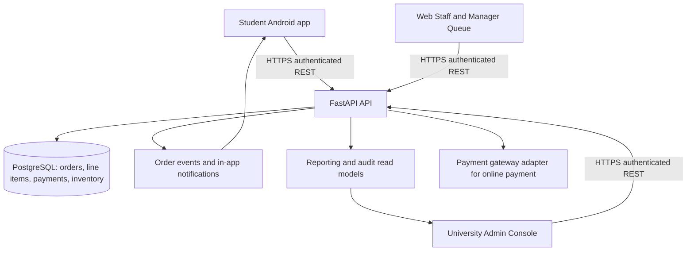
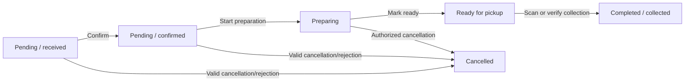

# UniServe: Food-ordering operations architecture (October 2026)

## Goal and boundary

Deliver a Foodpanda-style **campus pickup** experience while retaining UniServe's
existing FastAPI modular monolith, PostgreSQL database, Expo student app and
Next.js operations console. Do not replace working ordering, payments, identity
or inventory logic without a demonstrated defect. No delivery riders or address
routing are in scope; students collect orders at LGU cafeterias.

The *one source of truth* is the FastAPI order state persisted in PostgreSQL.
The Android application and web dashboard are views/controllers of that state,
never independent stores of authoritative order status.

## Components

## Roles and ownership

| Role | Can create order | See operational queue | Update order status | Scope |
|---|---|---|---|---|
| Student / Faculty | Yes | Own order detail only | No staff actions | Own identity |
| Cafeteria Staff | No (staff queue) | Yes | Confirm, prepare, mark ready, collect, delay | Assigned cafeteria |
| Cafeteria Manager | No (operations role) | Yes | Staff actions, reject/cancel and close-day under validated business rules | Assigned cafeteria |
| University Admin | Oversight | Yes | Existing backend explicitly allows confirm, prepare, ready, collect and delay | Across cafeterias, with audit trail |

Do not silently grant a new permission in the UI; every transition is
enforced again by the backend. University Admin status actions already exist
in the current router and Next.js source; if they do not appear in a live
browser, verify the *deployed frontend revision* before touching RBAC.

## Order state machine

- The interface should display one clearly labeled primary **next action**
  on each live order (not just **Details**), plus a details/audit panel.
- Payment is independent from the kitchen lifecycle: **cash at counter** and
  **online payment** must not be confused with cooking status. Only a
  successful payment outcome may be counted as paid revenue.
- The server should reject invalid or repeated transitions and keep an
  auditable actor, timestamp, and event. Never flip a mobile-local status
  optimistically as the source of truth.
- The order number, cafeteria name, items, totals, pickup method and current
  state must match in mobile and web.

## Operational screens

**Student app**: cafeteria selection → published menu → cart → checkout
→ confirmation/order number → live status timeline → ready notification
→ secure pickup confirmation. Show failed requests as errors; never
misrepresent a pending request as success.

**Staff & manager web**: active cafeteria selector; **All / Pending /
Preparing / Ready** queue; prominent primary next action; order number,
elapsed time, item counts, customer pickup information, ETA; mobile updates
on the next event/poll. All filters visible and clearable.

**University admin**: platform-wide dashboard plus per-cafeteria operations
with clear scope selector. Admins may perform the *already authorized*
transition actions, but role and audit context must be explicit. No
hidden operational controls or raw collection tokens.

**Notifications**: separate status changes and broadcast messages; show
timestamps and read/unread state. Do not claim native push notifications:
the current broadcast console explicitly creates in-app notifications only.

**Inventory, reports, payments**: every order/transition must use existing
transactional services; no duplicate inventory deduction; reports count
payments according to the documented payment-success definition, not
unpaid order totals.

## Deployment architecture is part of system design

The GitHub `main` commit is the intended web source of truth, but a Vercel
*commit-specific URL* is a snapshot and will not move when `main` changes.
`uniserve-web-dashboard-mo5nzfure-pakmultilinks-dot.vercel.app` has that URL
shape and visually differs from `main`: it shows no **Ready** button
for a Preparing order and reveals a full collection token whereas current
source has a Ready action and masks the token. This is a strong deployment
mismatch indicator; it should be verified by inspecting the deployment's
commit in Vercel.

Release checklist:
1. Link Vercel project to the intended repository and production branch.
2. Confirm `NEXT_PUBLIC_API_URL` points at the *same* live HTTPS API as
   `EXPO_PUBLIC_API_BASE_URL` baked into the Android APK.
3. Verify migrations and `/api/v1/health/ready` on the active API deployment.
4. Build frontend from reviewed `main` and compare the visible web build
   SHA with the deployed commit. Open a **production alias**, not an old
   commit-specific URL.
5. Keep collection tokens secret; use backend-validated pickup flows.
6. Perform a nonfinancial test order in a disposable/staging environment.
   Do not send real online payments or alter historic live orders as a test.
7. On a real Android device and browser, verify one new order end-to-end
   while staff transitions it through each legitimate status.

## Acceptance scenarios

| Scenario | Expected outcome |
|---|---|
| Student creates cash pickup order in Student Cafeteria | API returns one order number; same number visible in student history and selected staff queue |
| Staff confirms and begins preparation | Student timeline changes to Preparing; audit records actor and time |
| Preparing order opened by university admin | Modal and queue both visibly offer **Ready** on a matching up-to-date deployment |
| Authorized user marks ready | API persists Ready, dashboard updates, student gets correct in-app notification |
| Authorized staff collects | Server verifies valid collection, persists Completed, and reports update correctly |
| Browser opens a recent order from the Admin home | Correct cafeteria selected; stale status/date filters do not hide the linked order |
| Older Vercel link opened | Build provenance reveals old commit; operator redirects to the current production URL |
| Unauthorized user attempts transition | API responds forbidden; no DB mutation or fabricated success |
| Timeout / offline / API error | Explicit retryable error, never silently empty or successful |
| Invalid repeated status transition | HTTP error with no double payment, no duplicate inventory change |

## Concrete observed case: Order #15

The user-provided screenshots show Order #15 for Student Cafeteria,
PKR 420, with Preparing on **both** the Android order detail and the
university admin's web recent orders and queue. The modal on that deployed
web URL lacks the transition buttons that exist in current GitHub source.
This is principally a version/provenance and operator UX problem, **not**
proof that the order was lost or that a new microservice architecture is
necessary.

**Release gate:** No production-ready claim without both a build-commit
match and a real staff-action-to-student-notification demonstration.
